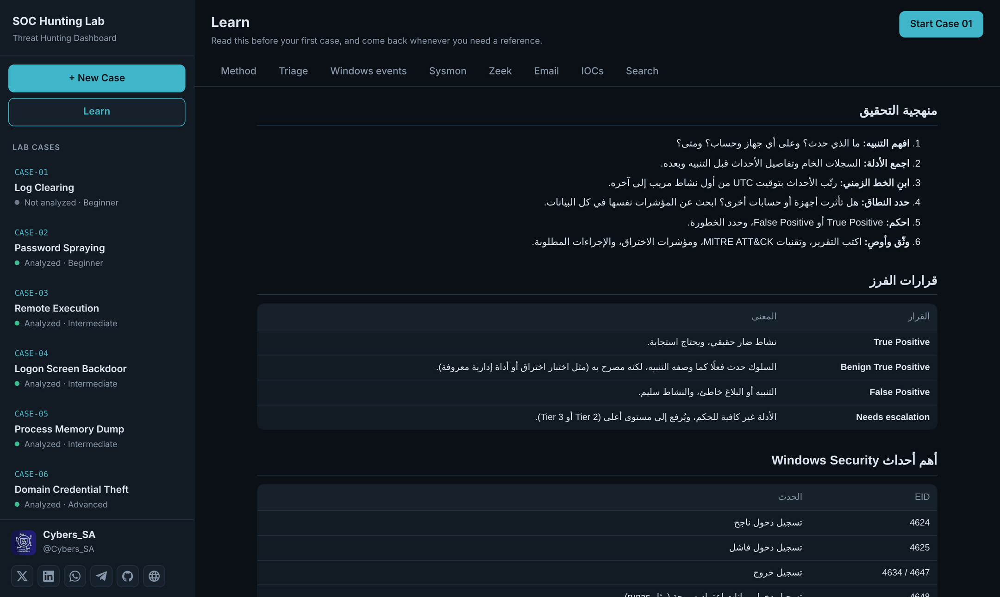
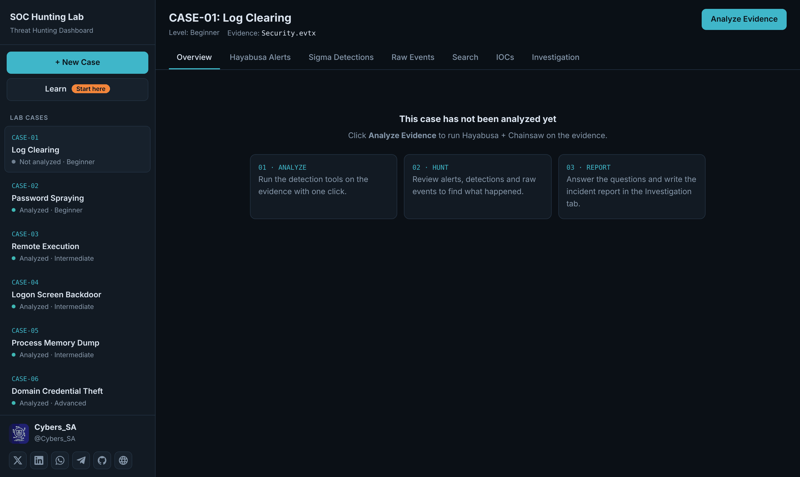
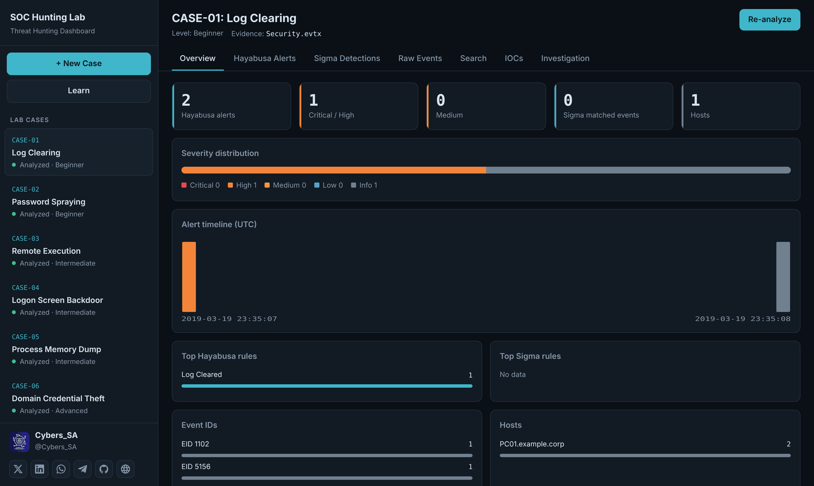
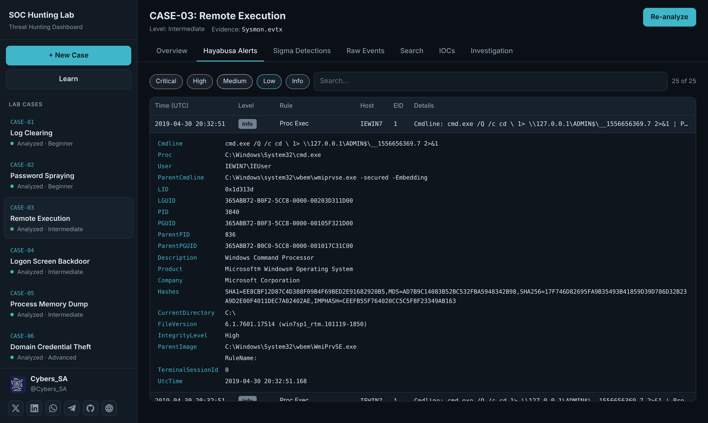
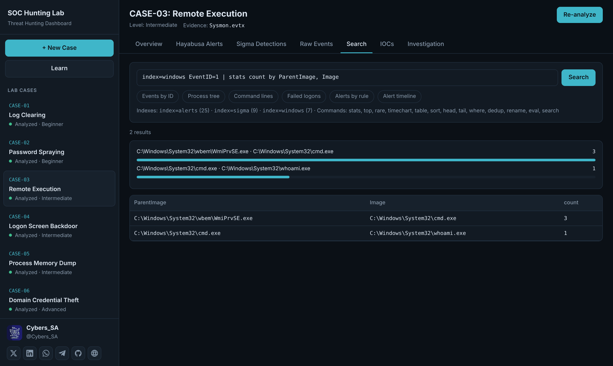
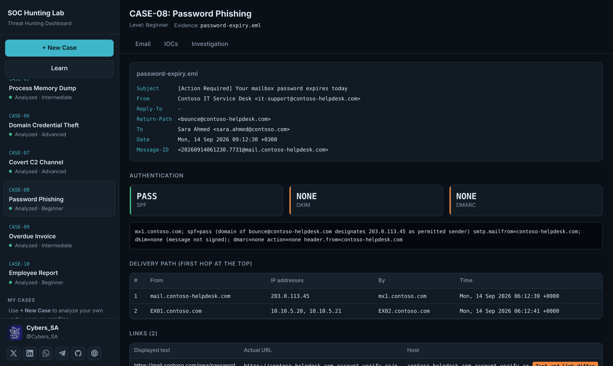
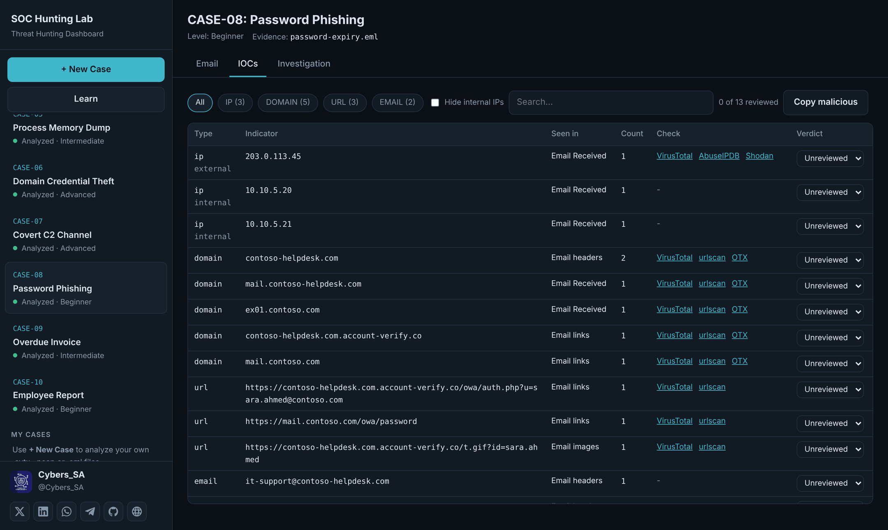
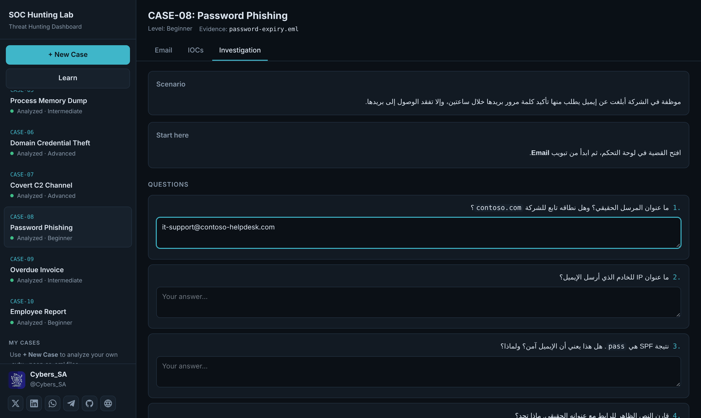
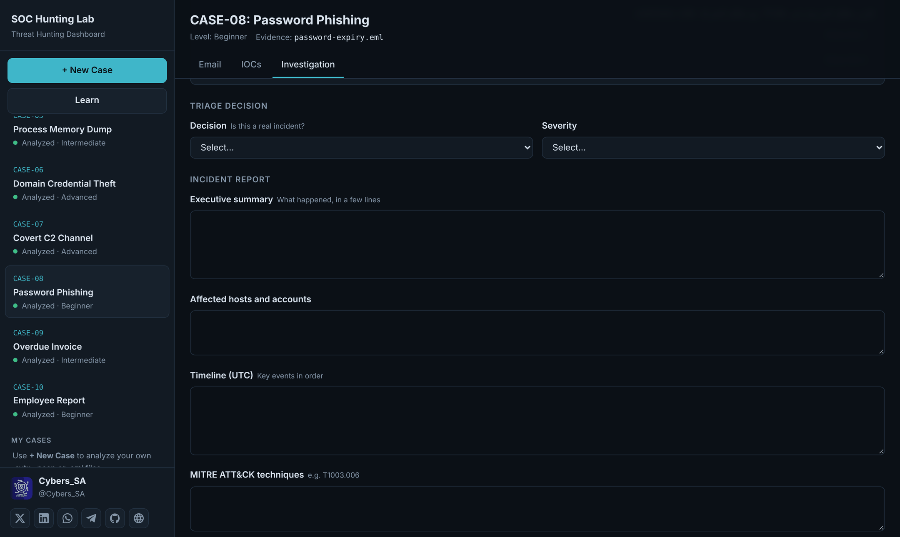
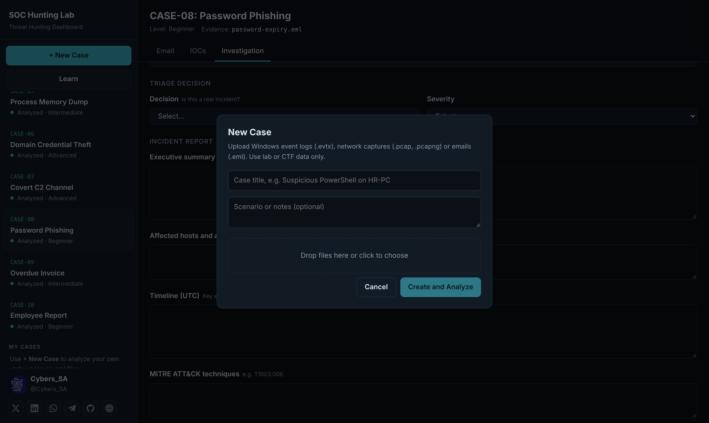

# دليل استخدام مختبر صيد التهديدات SOC

## 1. التشغيل

1. من صفحة المستودع اضغط زر **Open in GitHub Codespaces**.
2. تأكد من **Region: Europe West** و **Machine type: 2-core**، ثم اضغط **Create codespace**.
3. انتظر حتى ينتهي التجهيز وتظهر في الطرفية شاشة **SOC Hunting Lab** (من 3 إلى 8 دقائق في المرة الأولى).
4. افتح تبويب **Ports** أسفل الشاشة، واضغط أيقونة الكرة 🌐 بجانب المنفذ **8000** (SOC Dashboard).

إذا ظهر **HTTP ERROR 401** أو **404**، راجع [حل المشكلات](#حل-المشكلات).

## 2. ابدأ من Learn ⚠️

> **قبل أول قضية، اقرأ صفحة Learn.** تفتح تلقائيًا في أول زيارة، وزرها في القائمة الجانبية عليه علامة **Start here**.

فيها كل ما تحتاجه للتحقيق: المنهجية، وقرارات الفرز، وأهم أحداث Windows و Sysmon، وسجلات Zeek، وتحليل الإيميل، و Threat Intel، وأوامر Search. ارجع لها أثناء حل أي قضية.

عند الانتهاء اضغط **Start Case 01**.

## 3. حلّل الأدلة

اختر القضية من القائمة الجانبية واضغط **Analyze Evidence**. التحليل يستغرق ثوانٍ.

## 4. نظرة عامة

تبويب **Overview** يعرض عدد التنبيهات، وتوزيعها حسب الخطورة، والخط الزمني للهجوم، وأكثر القواعد تنبيهًا، والأجهزة وأرقام الأحداث.

## 5. التنبيهات والأحداث

- **Hayabusa Alerts:** جدول التنبيهات مع التصفية حسب الخطورة والبحث. اضغط أي تنبيه لترى تفاصيله كاملة.
- **Sigma Detections:** الأحداث المطابقة لقواعد Sigma.
- **Raw Events:** كل أحداث السجل، مع التصفية حسب رقم الحدث.

## 6. البحث بالاستعلامات

تبويب **Search** يبحث في كل بيانات القضية بلغة استعلام بصيغة Splunk (SPL). اضغط أحد الأمثلة الجاهزة للبدء، وإذا كانت النتيجة أرقامًا يظهر رسم بياني تلقائيًا.

## 7. تحليل الإيميل

في قضايا التصيد، تبويب **Email** يعرض المرسل و Reply-To و Return-Path، ونتائج SPF و DKIM و DMARC، ومسار الإيميل، والروابط، والمرفقات وبصماتها.

## 8. مؤشرات الاختراق

تبويب **IOCs** يستخرج المؤشرات تلقائيًا. افحص كل مؤشر خارجي من الروابط بجانبه، ثم صنّفه **Malicious** أو **Suspicious** أو **Benign**.

## 9. التحقيق والتقرير

تبويب **Investigation** فيه:

- **Scenario** و **Start here**: القصة ونقطة البداية.
- **Questions**: اكتب إجابتك تحت كل سؤال.
- **Hints**: افتح التلميحات واحدًا واحدًا إذا احتجت.

- **Triage decision**: القرار (True Positive أو False Positive) والخطورة.
- **Incident report**: الملخص، والأجهزة والحسابات، والخط الزمني، و MITRE ATT&CK، والمؤشرات، والتوصيات.

كل شيء يُحفظ تلقائيًا. اضغط **Download report** لتحميل التقرير.

## 10. حلّل ملفاتك

اضغط **+ New Case**، واكتب عنوان القضية، وارفع ملفات `.evtx` أو `.pcap` أو `.pcapng` أو `.eml`، ثم **Create and Analyze**. تظهر القضية تحت **My Cases**.

استخدم بيانات المختبرات وتحديات CTF فقط، ولا ترفع سجلات من بيئة عمل حقيقية.

## حل المشكلات

| المشكلة | الحل |
| --- | --- |
| **HTTP ERROR 401** | من تبويب **Ports** اضغط بالزر الأيمن على المنفذ 8000، ثم **Port Visibility** ← **Public**. |
| **HTTP ERROR 404** | من تبويب **Ports** اضغط بالزر الأيمن على المنفذ 8000 ← **Stop Forwarding Port**، ثم **Forward a Port** واكتب `8000`. |
| لوحة التحكم لا تفتح | اكتب في الطرفية `bash bin/dashboard` ثم افتح الرابط الظاهر. |

## الإيقاف

من [github.com/codespaces](https://github.com/codespaces) اضغط **⋯** بجانب الـ Codespace ← **Stop codespace** بعد كل جلسة. الإجابات والقضايا تبقى محفوظة حتى تحذفه.

